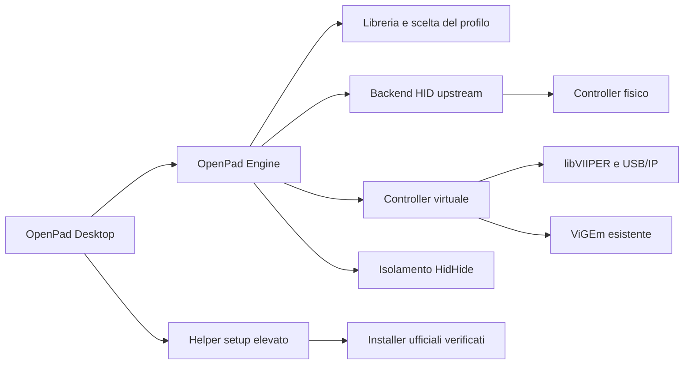

# Come funziona OpenPad

**Powered By RagazzoInGamba - Marco Laudati**

L'obiettivo è collegare un pad e giocare con i comandi previsti dal titolo. La parte tecnica serve a rendere questa esperienza affidabile e a spiegare i limiti quando ci sono. Per il percorso utente c'è il [manuale funzionale](functional.md).

## Architettura

OpenPad è un'app desktop Windows x64, compilata per .NET 10 con interfaccia Avalonia. Il frontend è indipendente dalla GUI originale di DualSense Client; le librerie hardware upstream restano la base per HID, DualSense, emulazione e HidHide.

| Componente | Responsabilità |
| --- | --- |
| `OpenPad.Desktop` | Schermate, prima configurazione, libreria, tray, avvio dei giochi e stato presentato |
| `OpenPad.Engine` | Inventario dei pad, modalità, catalogo, selezione della partita, riconciliazione e isolamento |
| `OpenPad.Updates` | Feed firmato, policy del canale, validazione dei pacchetti e integrazione Velopack |
| Librerie `DualSenseClient.*` | Comunicazione HID/BT, report DualSense, mapping, emulazione e accesso HidHide riutilizzati dall'upstream |
| HIDAPI | Accesso alle periferiche HID |
| libVIIPER + USB/IP | Endpoint virtuali moderni e percorso DualSense virtuale |
| ViGEm già presente | Fallback Xbox legacy; non viene installato dal setup OpenPad |
| HidHide | Visibilità del pad fisico quando il virtuale è operativo |

Il processo normale lavora senza privilegi amministratore. L'elevazione è limitata al setup dei driver, avviato dall'azione esplicita dell'utente.

## Controller e comandi originali

`OpenPadEngine` scopre i DualSense attraverso il backend HID e interroga gli slot XInput di Windows. DualSense Edge è implementato dal backend, ma richiede ancora prove fisiche dedicate. I pad HID senza backend specifico vengono inventariati: essere rilevati non significa poterli convertire in qualsiasi protocollo.

L'apertura, il monitoraggio e la chiusura di un DualSense avviato direttamente in modalità nativa non applicano profili LED o effetti trigger. Test con HID simulato verificano l'assenza di scritture output e feature report in quel percorso. La conversione esplicita e il feedback ricevuto dal gioco hanno invece un proprio ciclo di vita.

| Modalità | Comportamento |
| --- | --- |
| Nativa | Il gioco vede il controller reale e gestisce ciò che supporta |
| Compatibilità Xbox | Il DualSense viene esposto come Xbox con mapping standard |
| DualSense virtuale | Un endpoint virtuale DualSense viene alimentato dal controller fisico |
| DualShock 4 virtuale | Endpoint DS4 V1/V2 scelto esplicitamente, via USB/IP; nessun grilletto adattivo DualSense |

In modalità Xbox, Cross corrisponde ad A, Circle a B, Square a X e Triangle a Y. OpenPad non riscrive i binding del gioco. Il tuning consigliato conserva mapping, zone morte e feedback, senza overclock, polling imposto o cattura audio di sistema come impostazione iniziale.

## Scelta automatica e stabilità

`AutomaticCompatibilityPolicy` combina controller, collegamento, driver operativi e catalogo incorporato. La decisione contiene modalità, motivo, livello di evidenza ed eventuale driver mancante.

1. Xbox/XInput resta nativo.
2. DualSense USB con supporto nativo documentato nel catalogo resta nativo.
3. Per un titolo documentato via USB e un DualSense Bluetooth, USB/IP permette di proporre DualSense virtuale. Questo percorso deve essere provato sul PC.
4. Senza una regola nativa documentata viene proposta la compatibilità Xbox, quando disponibile.
5. Se manca il backend necessario, il pad resta nativo con la spiegazione del limite.

Le eccezioni dell'utente per il singolo gioco hanno precedenza sulla preferenza avanzata abilitata e sulla raccomandazione automatica. `ControllerModeSelection` applica questo ordine anche nella preparazione prima del lancio; una preferenza avanzata disattivata non entra nella selezione. Il catalogo contiene fonti e condizioni: non si deducono funzioni avanzate dal nome di un eseguibile. Uno Steam App ID conosciuto è un'identità più forte del titolo; edizioni con lo stesso ID possono richiedere anche un marcatore nel nome installato.

`GameSessionSelector` dà priorità al gioco riconosciuto in primo piano. Passare al desktop conserva la partita ancora aperta; con più giochi e nessuna scelta univoca la UI chiede di portare in primo piano quello desiderato. L'attesa di avvio dura al massimo 90 secondi e non scavalca un'altra partita effettivamente in primo piano.

Avviando dalla libreria OpenPad, la modalità viene preparata prima del gioco. `ProfileModeReconciler` conserva una baseline per ciascun controller e scarta lavoro superato da nuove preferenze, hotplug o chiusura. Un errore su un pad non impedisce di gestire gli altri. Una modalità già selezionata non viene ricreata a ogni controllo.

Le modifiche passano attraverso gate seriali. Una sessione funzionante conserva il backend. Per nuove sessioni Xbox viene usato ViGEm quando già disponibile, altrimenti USB/IP; DualSense virtuale usa USB/IP.

## Scoperta e avvio dei giochi

La scansione legge metadati locali: manifest Steam VDF/ACF, manifest Epic, registrazioni e cartelle mirate degli altri launcher. Le cartelle `XboxGames` sui dischi fissi vengono cercate senza forzare l'accesso a `WindowsApps`. `MicrosoftGame.config` viene letto con DTD disabilitato, limite di dimensione e controllo dei percorsi dichiarati.

La ricerca degli eseguibili è limitata in profondità e numero di elementi; esclude tool, updater e directory di supporto e non segue liberamente punti di reindirizzamento. Le partite si riconoscono tramite percorsi, non dal solo nome del processo. I giochi aggiunti manualmente richiedono l'eseguibile esatto.

L'avvio usa un URI Steam oppure un eseguibile valido dichiarato dai metadati o scelto dall'utente. Non viene lanciato il primo `.exe` trovato. I giochi Xbox/GDK restano affidati all'app Xbox o al contesto registrato, per mantenere l'identità richiesta dal runtime. Le copertine riusano la cache Steam locale; OpenPad non scarica inventari online per comporre la libreria.

## Setup dei driver e confine amministratore

Il manifest incorporato fissa URL, versione, SHA256, certificati ammessi e argomenti. Non viene scaricato un manifest remoto capace di sostituire queste decisioni.

| Pacchetto fissato | Ruolo | SHA256 |
| --- | --- | --- |
| USB/IP 0.9.8.1 x64 | Driver UDE e filtro USB per libVIIPER | `38CAD6D4432B52D5BB9409D9AD03B72FDFFC4ADA4CD3A48FBECA1A2752A8518A` |
| HidHide 1.5.230.0 x64 | Filtro di visibilità dei controller | `F4BBBCB82E6258641B887C74BC81C4C5F66E4AA811808DFC304347687B7605F6` |

I pin e i certificati sono in [DriverPackages.json](https://github.com/MarcoLaudati/OpenPad-Releases/releases/download/v0.7.3/OpenPad-0.7.3-source.zip); provenienza e licenze sono in `third-party`. La versione USB/IP corrisponde al requisito del [README libVIIPER v1.0.1](https://github.com/DualSenseClient/VIIPER/blob/v1.0.1/README.md).

Il flusso ricontrolla giochi aperti e stato Windows; verifica SHA256, Authenticode/WinVerifyTrust e certificato ammesso; quindi richiede UAC per il solo helper. Lock di lettura impediscono di sostituire i file durante la verifica. L'helper verifica nuovamente e prepara i pacchetti in directory amministrative protette, nuove e non prevedibili, rifiutando percorsi con reparse point.

Vengono eseguiti soltanto i componenti mancanti. Versioni esistenti sconosciute o incompatibili non sono sostituite alla cieca. Il risultato viene scritto nella directory protetta: il processo normale può leggerlo, non sostituirlo. Una volta partito un installer kernel, la cancellazione non lo termina forzatamente.

USB/IP può riconnettere gli hub USB anche quando è vietato il riavvio automatico del PC. I setup dei produttori gestiscono i prerequisiti Microsoft; un componente mancante può richiedere Internet.

### Esiti e ripresa

| Esito | Gestione |
| --- | --- |
| `0` | Passaggio riuscito; segue la verifica operativa |
| `3010` | Riavvio finale conservato; un pacchetto indipendente successivo può proseguire se Windows non introduce blocchi |
| `1641` | Catena interrotta: l'installer segnala l'avvio del riavvio |
| Annullamento o errore | Catena fermata, conservando un riavvio già richiesto |

`SetupWorkflow` salva intento e nonce prima di UAC. Un esito mancante non diventa un successo e non scatena un secondo installer. Alla riapertura l'app recupera il risultato dal percorso amministratore protetto.

Il riavvio richiesto dall'installer resta pendente nello stesso avvio kernel. Il confronto usa `Win32_OperatingSystem.LastBootUpTime`, letto tramite WMI e normalizzato in UTC, con cache per processo e attesa limitata a tre secondi. Se il dato non è verificabile, la UI distingue l'incertezza da un nuovo riavvio obbligatorio.

`SystemRebootPolicy` separa CBS/Windows Update, operazioni su file e letture sconosciute. Una semplice cancellazione non legata ai driver non viene presentata come riavvio Windows obbligatorio. Sostituzioni, operazioni sui driver o fonti non leggibili possono sospendere il setup con il proprio motivo. La coda Windows non viene cancellata per far sparire un avviso.

## HidHide e recupero

L'isolamento accompagna un endpoint virtuale funzionante. Prima di nascondere il fisico, OpenPad rende il dispositivo visibile a sé stesso e verifica che il percorso appartenga al pad Sony atteso, escludendo le periferiche virtuali.

Il journal registra le sole modifiche di OpenPad prima di applicarle. Whitelist, blacklist e impostazioni preesistenti dell'utente sono conservate; configurazioni inverse o combinazioni non gestibili non vengono normalizzate alla cieca. Ritorno nativo, scollegamento e chiusura rilasciano le modifiche di proprietà dell'app.

Un helper di recupero confronta PID e istante di avvio del proprietario, evitando di confondere un PID riutilizzato con la sessione precedente. Non modifica il journal di un proprietario ancora vivo. Regole conservate per incertezza non vengono dichiarate come protezione verificata.

HidHide operativo, pad fisico nascosto e assenza pratica di doppi input sono osservazioni distinte. Un gioco o remapper che aveva già aperto il pad può richiedere riconnessione o riapertura.

## Stato osservato e UI

`PadSnapshot` separa la modalità selezionata da `IsModeOperational`, `IsPreparing` e `DuplicateInputProtected`. Per ViGEm, l'indice assegnato deve comparire anche negli slot XInput. Per Xbox USB/IP, lo stato del backend va accompagnato da uno slot XInput osservato e attribuibile senza ambiguità. `ModeCaption` indica una modalità non operativa invece di mostrarla come attiva.

La protezione dai doppi input è `null` se non applicabile o incerta, `false` se non attiva e `true` soltanto con conferma dell'isolamento. La frequenza report mostrata non misura la latenza completa fino al gioco.

Il setup distingue componenti presenti, compatibili e operativi. **Configurazione completa** richiede tutti i componenti operativi, nessun blocco e nessun esito da recuperare. Due servizi visibili non cancellano una richiesta esplicita di riavvio.

## Preparazione e recupero dalla 0.5.0

Il percorso **Gioca** usa `ProfileGamePreparation` per conservare le baseline e attende `PrepareForGameAsync`: endpoint osservato, stessa sessione fisica e isolamento confermato quando serve la conversione. Soltanto il coordinator avvia la creazione; `RecordPreparedModes` registra il risultato senza un secondo passaggio hardware. `GamePreparationCoordinator` prepara i controller in sequenza. Il limite è otto secondi per un pad, quattro secondi aggiuntivi per pad fino a un massimo di venti. Il tempo include le operazioni cooperative e l'attesa dei lock; il percorso UI ha inoltre un limite complessivo di venti secondi per preparazione e nuovi tentativi.

Un errore interrompe l'avvio automatico e mostra **Riprova** e **Avvia comunque**. Quest'ultimo è una scelta esplicita della persona e usa la compatibilità disponibile, senza trasformare l'errore in una riuscita. Il controllo resta attivo anche con profili automatici disabilitati; non impone una rimappatura personale.

`ControllerRecoveryPolicy` consente tentativi limitati e un intervallo di assestamento. Una creazione ancora pendente non viene ricreata a ogni tick. `EmulationService.Refresh(device)` riguarda il solo dispositivo richiesto e conserva le altre sessioni in corso. Il ritorno al nativo mantiene il ripristino della visibilità e degli output di proprietà dell'app.

Una sessione virtuale già operativa conserva il backend. Per una nuova sessione Xbox, ViGEm viene usato se già disponibile, perché espone lo slot assegnato; OpenPad non ne installa una nuova copia. In sua assenza usa USB/IP. Per DualSense virtuale usa USB/IP. Non viene applicato un fallback silenzioso da DualSense a Xbox che possa far sparire le funzioni scelte.

## Input visivi, navigazione e verifica hardware

`PadInputSnapshot` contiene assi normalizzati, grilletti, pulsanti, istante osservato e sessione della sorgente. La normalizzazione non modifica i report inviati al gioco e non applica zone morte. `GetInput(id)` legge i dati freschi senza eseguire la riconciliazione dei driver. Dalla 0.5.1 il campionamento visivo resta a circa 30 Hz mentre la finestra è visibile, anche senza focus; minimizzazione e tray lo sospendono. `GamepadFrameDispatcher` separa il refresh dalle azioni: soltanto la finestra attiva può usare il pad per la navigazione. I report vecchi non sono considerati input attuali e l'avviso di attesa ha precedenza anche nella prova dei tasti.

`GamepadInputPolicy` filtra timestamp vecchi o futuri, assi non validi e pressioni già presenti all'ingresso. Una nuova finestra, un nuovo pad o il ritorno dal background richiedono il rilascio dei comandi. `GamepadNavigation` agisce sui controlli della sola finestra OpenPad attiva, con ripetizione limitata delle direzioni e senza inviare tasti al sistema operativo. Le azioni di setup e riavvio attivate dal pad hanno una conferma dedicata. La ricerca dispone di una tastiera locale: **Cerca** applica il testo, **Annulla** lo conserva com'era. Le scelte dai menu aperti col pad passano da un selettore locale: spostare il focus non salva un profilo; soltanto la conferma assegna una nuova selezione e B/cerchio annulla.

`ControllerVisualizer` disegna tasti, stick e grilletti dai dati reali. Durante la prova dei tasti il focus resta sulla visuale e i comandi non attivano gli altri pulsanti. Le scelte manuali e i valori grezzi sono raccolti in **Avanzate**.

`HardwareCheckModel` conserva una checklist di osservazioni locali. La riconnessione e il passaggio USB/Bluetooth richiedono un'identità fisica stabile e nuovi report; il numero dello slot XInput non viene trattato come identità del controller. La ripresa richiede una [notifica Windows di resume](https://learn.microsoft.com/windows/win32/api/powerbase/nf-powerbase-powerregistersuspendresumenotification) e input successivi. Il semplice trascorrere del tempo non prova la sospensione.

`FeedbackTestRunner` esegue una breve prova soltanto su richiesta e fuori dalle partite rilevate, con un controllo aggiornato anche durante l'effetto e ripristino in `finally`. L'invio di un comando e l'effetto percepito restano distinti: **Confermato da te** indica una risposta umana. Il test della vibrazione non certifica la fedeltà dell'aptica del gioco.

Il report locale `hardware-check-latest.json` contiene gli esiti e i passaggi da provare, senza indirizzi del pad o percorsi dei dispositivi. Le prove dei report simulati restano distinte dal collaudo fisico. Il [catalogo delle funzioni documentate](game-compatibility.md) separa USB, Bluetooth e percorso virtuale.

## Effetti LED opzionali

`PadLightingSettings` è separato da profili, mapping e `RecommendedTuning`. Il default `Game` non avvia un writer. `LightingEffects` genera frame RGB e, solo per Supercar, la maschera di scansione dei cinque player LED bianchi. Luminosità e preferenze sono validate; Xbox/XInput e HID privi di backend non ricevono comandi luce.

`LightingSession` gestisce proprietà, pausa e rilascio per ciascun pad. Un loop a 20 Hz salta i frame quando il gate operativo è occupato e accorpa frame identici. `SetLighting` invia soltanto i flag RGB e, quando richiesto, player LED o spia microfono usando i report USB/Bluetooth già presenti. Il controllo manuale della spia è opt-in in Avanzate e non abilita il microfono. Non usa `ApplyProfile` e non aggiunge flag di vibrazione, audio o grilletti.

Gli eventi LED osservati nel processo forniscono le sole baseline note; un contesto `AsyncLocal` esclude i frame della nostra animazione. I colori di un'app nativa esterna non sono una lettura disponibile. Pausa, cambio effetto e chiusura rilasciano soltanto stato noto e di proprietà della sessione. I guasti cosmetici restano in `Lighting.Status` e non bloccano la readiness del gioco.

Il frontend conserva preferenze per identità fisica locale e le riapplica una sola volta per nuova sessione, dopo un controllo aggiornato delle partite. `StartGameProcessAsync` attende la pausa prima di aprire il gioco. Gli effetti rispettosi sono sospesi anche con stato dei giochi sconosciuto. `GetLighting(id)` legge solo la snapshot per la preview e non enumera periferiche né esegue I/O HID. Le scelte in bozza non vengono sovrascritte dagli aggiornamenti di stato.

Per le semantiche visibili e i limiti hardware vedi [Stile e luci](lighting.md).

## Persistenza e dati locali

Le nuove opzioni sono descritte nei moduli `AdvancedControllerOptions`, `AdvancedOptionsStore`, `OpenPadEngine.Advanced` e `AdvancedAudioSession`. Il backend applica prima `RecommendedTuning`, poi soltanto l'overlay avanzato esplicitamente abilitato. Il mapper ViGEm riceve le stesse rimappature del percorso USB/IP. Profili caricati/importati diventano bozze disabilitate, validate prima dell'applicazione; l'importazione non esegue processi.

Le anteprime hanno cancellazione e proprietà della finestra. La chiusura attende il rilascio dei player creati dalla prova; il rilevamento di una partita e il lancio dall'app fermano l'output di anteprima. I preset dei grilletti sono tipizzati e brevi. La telemetria avanzata conserva timestamp e disponibilità dei dati: leggere gyro/accelerometro non implementa gyro-mouse.

| Posizione logica | Contenuto |
| --- | --- |
| `%LOCALAPPDATA%\OpenPad\preferences.json` | Automatico, titoli recenti e giochi aggiunti manualmente |
| `%LOCALAPPDATA%\OpenPad\games.json` | Eccezioni per eseguibile, backup e conservazione dei dati danneggiati |
| `%LOCALAPPDATA%\OpenPad\setup-progress.json` | Intento, fase, identità dell'avvio e nonce atteso |
| `%LOCALAPPDATA%\OpenPad\isolation.json` | Journal HidHide di proprietà di OpenPad |
| `%LOCALAPPDATA%\OpenPad\DriverPackages` | Cache dei pacchetti verificati |
| `%LOCALAPPDATA%\OpenPad\hardware-check-latest.json` | Esito esplicitamente salvato della verifica guidata, senza identificativi dei dispositivi |
| `%LOCALAPPDATA%\OpenPad\advanced` | Profili e preferenze avanzate validate; i nomi dei file per pad derivano da hash dell'identità locale |
| `%LOCALAPPDATA%\OpenPad\updates` | Preferenze e metadati dell'aggiornamento |
| `%LOCALAPPDATA%\Programs\OpenPad.App` | File dell'app installata e staging Velopack, separati dai dati personali |
| `%ProgramData%\OpenPad\Setup` | Lock, staging, log e risultati dell'helper elevato |
| `Config` nella directory dell'app | Store backend separato dalle preferenze upstream |

I pacchetti pubblicabili escludono configurazioni locali, log e simboli. I report diagnostici possono contenere percorsi, identificativi dei dispositivi e timestamp: vanno controllati e anonimizzati prima di condividerli.

## Limiti e provenienza

L'updater usa il canale pubblico `OpenPad-Releases`, feed HTTPS firmato RSA-PSS e chiave pubblica incorporata. Hash, dimensione, versione, architettura e struttura del pacchetto vengono verificati prima di programmare l'helper Velopack. L'auto-apply implicito all'avvio è disattivato: il frontend passa dalla chiusura controllata e dalle verifiche fresche di partita/setup. La chiave privata resta fuori da sorgenti e distribuzione. [Installer e aggiornamenti](updates.md) descrive il comportamento utente e il limite Authenticode attuale.

Il catalogo documenta alcuni titoli, non certifica tutte le installazioni. Aptica, trigger, giroscopio, audio e simboli dipendono dal gioco e dal collegamento. Steam Input e altri remapper possono sovrapporsi alla conversione. I pad generici richiedono backend specifici per funzioni non offerte dal titolo.

Il frontend e il pacchetto supportati qui sono Windows x64. Il codice Linux conservato dall'upstream non costituisce una release OpenPad Linux verificata. Vedi il [registro pubblico delle verifiche](https://github.com/MarcoLaudati/OpenPad-Releases/blob/main/VERIFICATION.md).

OpenPad riusa [DualSense Client](https://github.com/DualSenseClient/DualSenseClient) e mantiene GPL-3.0 e attribuzioni delle dipendenze. Il credito OpenPad non sostituisce gli autori upstream o dei driver. Vedi [CREDITS.md](https://github.com/MarcoLaudati/OpenPad-Releases/blob/main/CREDITS.md), [THIRD-PARTY-NOTICES.md](https://github.com/MarcoLaudati/OpenPad-Releases/blob/main/THIRD-PARTY-NOTICES.md) e [LICENSE](https://github.com/MarcoLaudati/OpenPad-Releases/blob/main/LICENSE).

**Powered By RagazzoInGamba - Marco Laudati**
